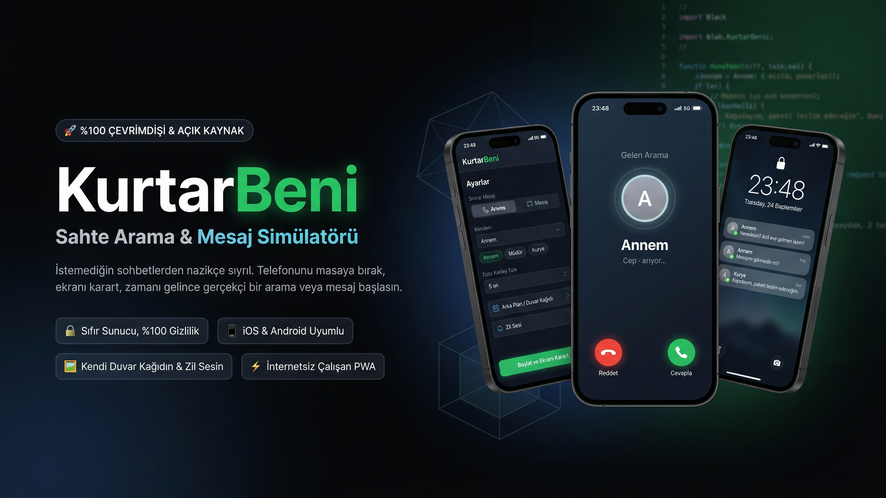
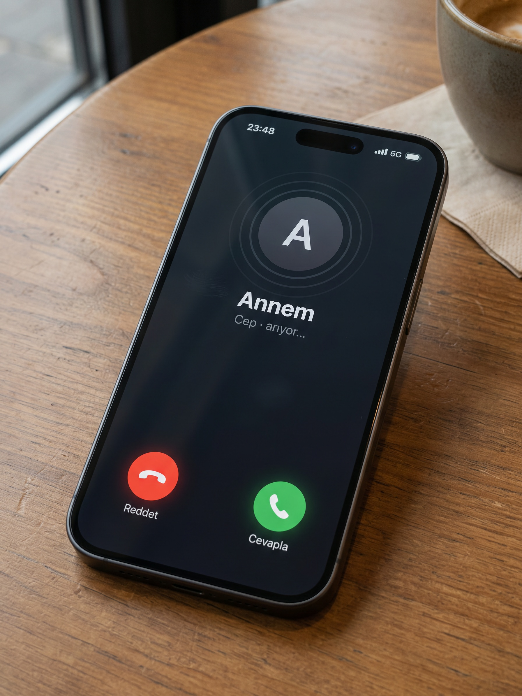

# 📱 KurtarBeni — Sahte Arama & Mesaj Simülatörü

  

  
  
  
  

  <strong>İstemediğin sohbetlerden veya uzayan toplantılardan nazikçe sıyrıl.</strong> 
  Telefonunu masaya bırak, ekranı karart, zamanı gelince gerçekçi bir arama veya mesaj akışı başlasın.

  <a href="https://enessivil.github.io/kurtarbeni/"><strong>🌐 Hemen Canlı Deneyin (PWA) →</strong></a>

---

## 🌟 Öne Çıkan Özellikler

- **🎭 İki Farklı Mod:** Gelen Arama simülasyonu veya kilit ekranında sırayla gelen SMS/Mesaj bildirim akışı.
- **🖼️ Kendi Duvar Kağıdınla Birebir Görünüm:** Telefonunun duvar kağıdını veya boş ekran görüntüsünü (SS) ekle; hem kilit ekranı hem de gelen arama arka planı (bulanıklaştırılarak) kendi cihazınla birebir aynı olsun.
- **🔕 Güç Tuşuna Basmadan Stealth AMOLED Karartma:** Başlat'a bastıktan 2 saniye sonra ekran tamamen simsiyah olur, cihaz kilitlenmeden masada bekler (tarayıcıların kilitliyken titreşimi durdurmasını engeller).
- **🎶 Stüdyo DSP Ses Sentezleyici & Özel Sesler:** iOS, Android ve akustik zil sesleri tarayıcı içinde gerçek zamanlı sentezlenir. Dilersen cihazından kendi zil sesini `.mp3` / `.wav` olarak yükleyebilirsin.
- **💡 Gerçekçilik Tüyoları & Zil Sesi Rehberi:** Markalara göre (iPhone, Samsung, Xiaomi vb.) orijinal zil sesi arama metinlerini kopyalayıp ekleme rehberi.
- **🔒 %100 Çevrimdışı & KVKK Dostu:** Hiçbir sunucu, veritabanı, çerez veya takip kodu içermez. Seçtiğin resim ve sesler sadece kendi cihazının yerel tarayıcı hafızasında (`IndexedDB`) saklanır.

---

## 📸 Ekran Görüntüleri

<table align="center">
  <tr>
    <td align="center" width="50%">
      <strong>⚙️ Ayar Ekranı & Tüyolar</strong> 
      
    </td>
    <td align="center" width="50%">
      <strong>📞 Gelen Arama Ekranı</strong> 
      
    </td>
  </tr>
</table>

---

## 🚀 Nasıl Kullanılır?

1. **[Canlı Uygulamayı Aç](https://enessivil.github.io/kurtarbeni/)**
2. **Ana Ekrana Ekle (Önerilen):** Tarayıcı menüsünden "Ana Ekrana Ekle" (Add to Home Screen) seçeneğiyle PWA olarak yükle. Artık uçak modunda bile çalışır!
3. **Ayarları Yap:** Arayan kişiyi, gecikme süresini, zil sesini ve kendi duvar kağıdını seç.
4. **Başlat:** "Başlat ve Ekranı Karart" butonuna dokun, ekran 2 saniye içinde kararacaktır. Telefonu masaya bırak.
5. **İptal Etme:** Bekleme ekranından çıkmak için ekrana **çift dokunman** yeterlidir.

⚠️ **Önemli İpucu:** Telefonunun medya ses seviyesinin açık olduğundan emin ol ve güç (kilit) tuşuna basma; tarayıcılar arka planda titreşim ve sesi durdurabilir.

---

## 🤝 Katkıda Bulunma (Contributing)

Projeye destek olmak, hata bildirmek veya yeni bir özellik önermek istersen kapımız açık!

1. Bu depoyu forklayın (`Fork`).
2. Yeni bir dal (branch) açın: `git checkout -b feature/harika-ozellik`.
3. Değişikliklerinizi yapın ve test edin:
   - *Kodun tamamen harici kütüphanesiz (vanilla JS/CSS), %100 çevrimdışı ve sıfır sunuculu kalmasına özen gösterin.*
   - *Eğer `index.html`, `app.js` veya `styles.css` güncellediyseniz `sw.js` içindeki `CACHE_NAME` sürümünü güncellemeyi unutmayın.*
4. Değişikliklerinizi commit edin: `git commit -m 'Eklendi: Yeni özellik'`.
5. Dalınızı push edin: `git push origin feature/harika-ozellik`.
6. Bir **Pull Request (PR)** oluşturun.

---

## 📜 Lisans & Yasal Uyarı

Bu proje **[MIT Lisansı](LICENSE)** ile lisanslanmıştır.

- **Yasal Uyarı:** Bu uygulama tamamen sosyal ortamlardan nazikçe ayrılmak, simülasyon ve kişisel konfor amacıyla geliştirilmiştir. Suç teşkil edecek, aldatıcı veya dolandırıcılık amaçlı kullanımlar tamamen kullanıcının sorumluluğundadır.
- **Acil Durumlar:** Gerçek acil durumlarda bu uygulama yerine doğrudan **112 Acil Çağrı Merkezi**'ni arayınız.
