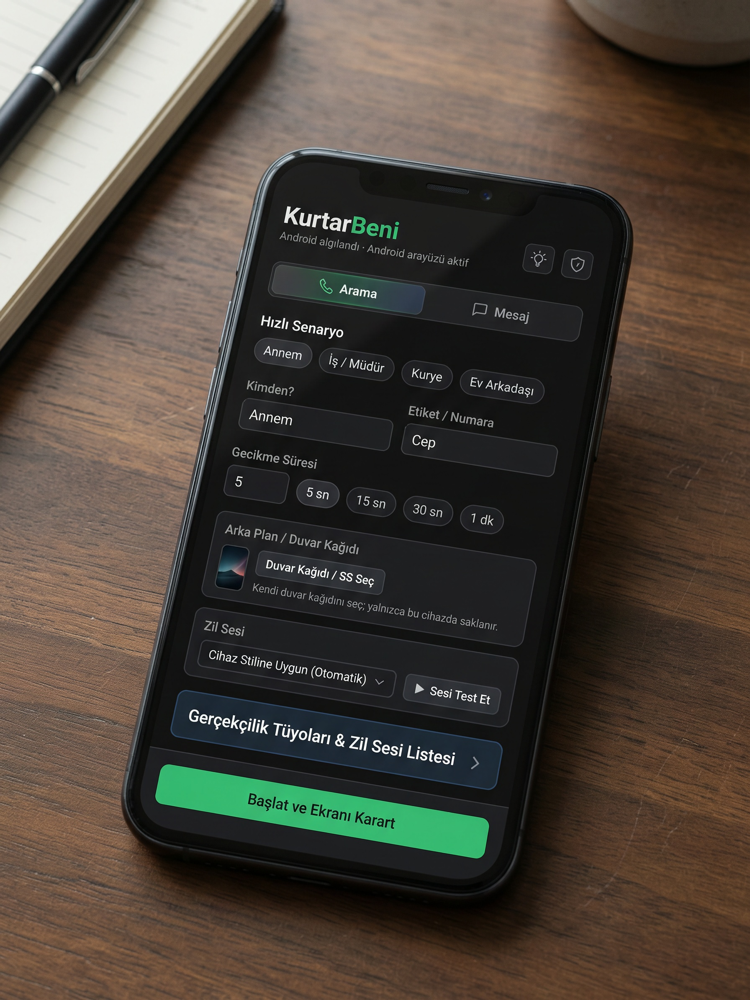

# 📱 KurtarBeni / RescueMe

  

  
  
  
  
  

  <a href="#-türkçe"><strong>🇹🇷 Türkçe</strong></a> •
  <a href="#-english"><strong>🇬🇧 English</strong></a>

---

## 🇹🇷 Türkçe

**KurtarBeni**, istemediğin bir sohbetten ya da uzayan bir toplantıdan nazikçe sıyrılman için geliştirilmiş; **reklamsız, sunucusuz, sıfır dış bağımlılıklı ve %100 çevrimdışı çalışan** açık kaynak bir PWA (Progressive Web App) uygulamasıdır.

🌐 **Hemen Kullan:** [https://enessivil.github.io/kurtarbeni/](https://enessivil.github.io/kurtarbeni/)

### Öne Çıkan Özellikler (v2.1.1)

- **⚡ Tırmanan Senaryo Zinciri (`Zincir` Modu):** Önce sakin bir mesaj, ardından acil ikinci mesaj ve hemen üstüne aynı kişiden gerçekçi gelen arama akışı.
- **🧮 Hesap Makinesi Kılığı (Kamufle Mod):** Tamamen çalışan gerçek bir hesap makinesine bürünür. İşlem girmeden sadece sayı + `=` yazdığında (ör. `15=`) kimse fark etmeden gizli geri sayım başlar. `AC`'ye çift dokunarak iptal edebilir, `AC`'ye 1.5 sn basılı tutarak ayarlara dönebilirsin.
- **🎙️ Ahize Filtreli Karşı Taraf Sesi:** Aramayı cevapladığında sessiz boşluk yerine gerçekçi telefon hattı ortam sesi veya `300–3400 Hz` telefon filtresinden geçirilmiş kendi ses kaydın çalar; *Hoparlör* ve *Beklet* butonlarına canlı tepki verir.
- **🆘 Sessiz Güvenlik Köprüsü (Acil SMS):** Gelişmiş bölümde güvendiğin bir kişinin numarasını kaydettiysen, görüşme ekranında **Beklet** tuşuna 2.5 sn basılı tutarak cihazının SMS uygulamasını önceden doldurulmuş yardım mesajıyla açabilirsin.
- **🖼️ Kendi Duvar Kağıdın & Özel Zil Sesin:** Telefonunun duvar kağıdını (kilit ekranı + bulanık arama arka planı) ve kendi ses dosyanı ekleyebilirsin. Tüm dosyalar yalnızca kendi cihazında (`IndexedDB`) çevrimdışı saklanır.
- **📱 Android & iOS Otomatik Algılama + TR / EN Dil Desteği:** Cihazına göre kilit ekranı, gelen arama ve hesap makinesi stilini otomatik uyarlar; tek dokunuşla Türkçe / İngilizce geçişi sunar.
- **🔒 Gizlilik & Güvenlik Sertleştirmesi:** Katı Content Security Policy (`script-src 'self'`, `connect-src 'self'`), sıfır `innerHTML`/`eval`, sıfır harici CDN/font, sıfır çerez/izleyici ve otomatik GitHub Actions güvenlik denetimi.

### Nasıl Kullanılır?

1. **[Canlı Uygulamayı Aç](https://enessivil.github.io/kurtarbeni/)** ve telefonunda **Ana Ekrana Ekle** ile kısayol oluştur (uçak modunda bile çalışır).
2. Modu (*Arama / Mesaj / Zincir*), arayan adını, süreyi ve istersen duvar kağıdı/zil sesini seç.
3. **Başlat ve Ekranı Karart** butonuna dokun (ya da sağ üstteki Hesap Makinesi kılığına geçip `15=` yaz).
4. **Önemli:** Güç tuşuna basıp ekranı kilitleme; 2 saniye içinde açılan AMOLED saf siyah ekran kapalıymış gibi görünür. Başlatmadan önce telefonun *Medya* ses düzeyini aç.

### Ekran Görüntüleri

<table align="center">
  <tr>
    <td align="center" width="50%">
      <strong>⚙️ Ayarlar &amp; Senaryo Zinciri</strong> 
      
    </td>
    <td align="center" width="50%">
      <strong>📞 Gelen Arama Ekranı</strong> 
      
    </td>
  </tr>
</table>

### Gizlilik, KVKK & Yasal Uyarı

- **Sıfır Veri İletimi:** Uygulama kodu geliştiriciye veya üçüncü taraflara hiçbir veri göndermez. Ayarlar ve seçtiğin medya dosyaları yalnızca kendi tarayıcının yerel deposunda (`localStorage` / `IndexedDB`) tutulur ve uygulama içinden tek tıkla kalıcı olarak silinebilir. Statik barındırma sağlayan **GitHub Pages (GitHub, Inc.)**, kendi güvenlik politikaları kapsamında ziyaretçi IP adreslerini loglayabilir.
- **Sessiz SOS Sınırı:** Sessiz SOS özelliği gerçek bir acil çağrı merkezi değildir; yalnızca cihazın SMS uygulamasını hazır taslakla açar. Gerçek acil durumlarda doğrudan **112 Acil Çağrı Merkezi**'ni arayın.
- **Yasal Kullanım:** Uygulama MIT Lisansı ile "olduğu gibi" sunulur; dolandırıcılık, tehdit, taciz veya hukuka aykırı herhangi bir amaçla kullanılamaz.
- **Marka Feragatnamesi:** iPhone, iOS, Android, Samsung, One UI, Xiaomi, Google Pixel ve Huawei adları yalnızca uyumluluk ve bilgilendirme amacıyla anılmıştır; ilgili hak sahiplerinin tescilli markalarıdır ve bu projenin bu markalarla resmi bağlantısı yoktur.

---

## 🇬🇧 English

**RescueMe (KurtarBeni)** is an open-source, **ad-free, serverless, zero-dependency, 100% offline PWA** designed to help you politely step out of awkward conversations or endless meetings.

🌐 **Try Live:** [https://enessivil.github.io/kurtarbeni/](https://enessivil.github.io/kurtarbeni/)

### Key Features (v2.1.1)

- **⚡ Escalating Scenario Chain (`Chain` Mode):** Delivers a calm first notification, followed by an urgent second message, and finishes with a realistic incoming call from the same person.
- **🧮 Calculator Disguise (Stealth Mode):** Looks and works like a real calculator. Type a plain number + `=` (e.g. `15=`) to silently arm a 15-second countdown. Double-tap `AC` to cancel, or press and hold `AC` for 1.5s to return to setup.
- **🎙️ Earpiece-Filtered Caller Audio:** Plays subtle phone-line ambience or your own uploaded audio clip filtered through a `300–3400 Hz` telephone bandpass filter when answered, responding live to *Speaker* and *Hold*.
- **🆘 Silent Safety Bridge (Emergency SMS):** Save an optional trusted contact in *Advanced* settings; holding the **Hold** button for 2.5s during an active call opens your native SMS app pre-filled with your help draft.
- **🖼️ Custom Wallpaper & Ringtone:** Use your own wallpaper (lock screen + blurred call background) and custom audio files, stored strictly offline on your device (`IndexedDB`).
- **📱 Auto Android/iOS UI + Bilingual (`TR | EN`):** Automatically adapts UI styling to iOS or Android and switches instantly between Turkish and English.
- **🔒 Hardened Security & Privacy:** Strict CSP (`default-src 'self'`, `script-src 'self'`), zero `innerHTML`/`eval`, zero external CDNs/fonts/cookies, and automated CI security checks on every push.

### Privacy & Legal Notice

- **Client-Side Only:** The app sends zero user data to any server. Preferences and custom media stay strictly in your device's browser storage (`localStorage` / `IndexedDB`) and can be wiped in one tap. Note that **GitHub Pages (GitHub, Inc.)**, as the static host, may log visitor IP addresses under its own security and privacy policy.
- **Emergency Disclaimer:** Silent SOS is not an emergency dispatch service — it only opens a pre-filled SMS draft. In any real emergency, call **112 / 911** immediately.
- **Trademarks:** iPhone, iOS, Android, Samsung, One UI, Xiaomi, Google Pixel, and Huawei are trademarks of their respective owners, mentioned solely for compatibility with no official affiliation.

---

## 🤝 Katkıda Bulunma / Contributing

Detaylı kurallar için [`CONTRIBUTING.md`](CONTRIBUTING.md) ve güvenlik bildirimleri için [`SECURITY.md`](SECURITY.md) dosyalarına göz atabilirsin. Her değişiklikte **sıfır dış bağımlılık**, **katı CSP uyumu** ve `sw.js` önbellek sürüm artışı zorunludur.

📜 Lisans / License: **[MIT](LICENSE)**
